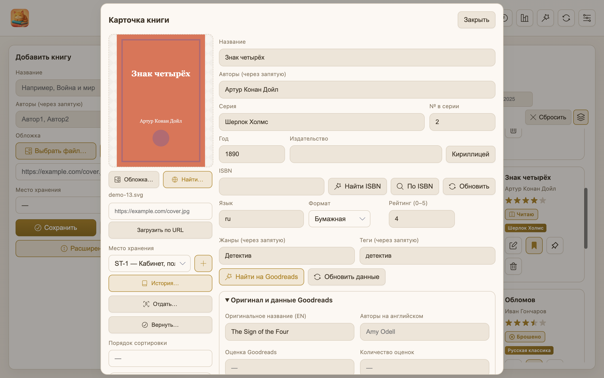
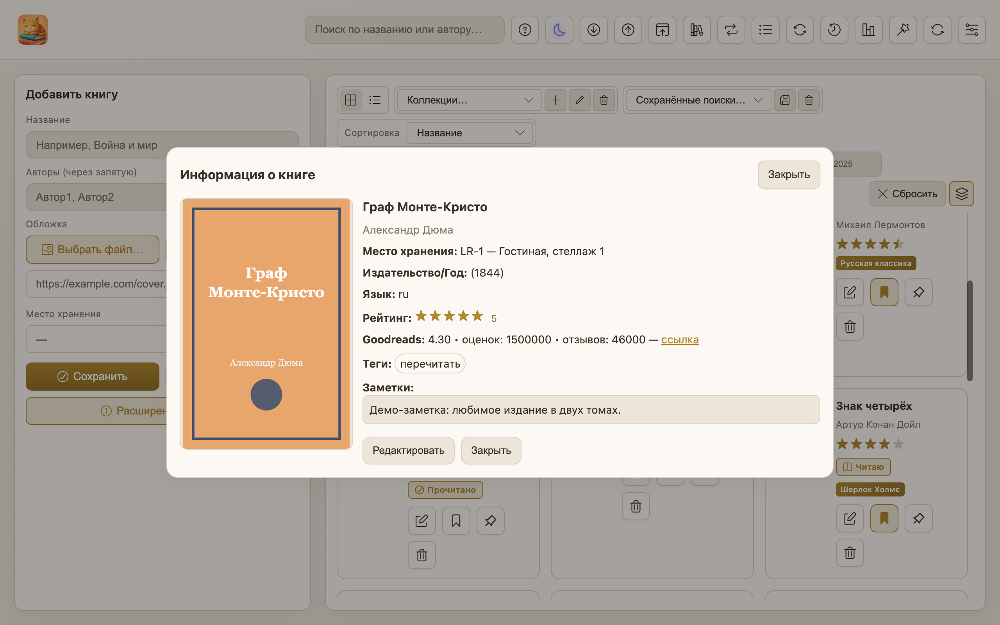

## Быстрое добавление

Форма **«Добавить книгу»** слева нужна, чтобы быстро занести книгу с минимумом данных:

1. Введите **название** и **авторов** через запятую.
2. При желании добавьте **обложку** (см. ниже) и **место хранения**.
3. Нажмите **«Сохранить»** или `Enter`.

Для всех остальных полей нажмите **«Расширенная форма»** — откроется полная карточка книги.

## Карточка книги

Полная карточка открывается кнопкой **«Расширенная форма»**, клавишей `N` (новая книга) или кнопкой
**«Редактировать»** на карточке в списке.

Поля карточки:

| Поле | Комментарий |
|---|---|
| Название, авторы | Авторы через запятую |
| Серия и № в серии | Используются в сортировке «Серия» и поиске `series:` |
| Год, издательство | Кнопка **«Кириллицей»** переводит латинскую транслитерацию издательства обратно в кириллицу |
| ISBN | Можно сразу подтянуть данные кнопкой **«По ISBN»**, см. [ISBN, AI и Goodreads](/guide/metadata/) |
| Язык | Код языка, например `ru` или `en` |
| Формат | Бумажная, электронная или аудио |
| Рейтинг (0–5) | Можно с половинками: `4.5` |
| Жанры, теги | Через запятую |
| Заметки | Свободный текст |
| Место хранения | Полка, где стоит книга, см. [Места хранения](/guide/storage/) |
| Порядок сортировки | Ручной номер: книга с номером поднимается выше всех, даже выше закреплённых |

Справа внизу кнопки **«Сохранить»** и **«Коллекции»**. Если закрыть карточку с несохранёнными
изменениями (крестиком или `Esc`), приложение спросит подтверждение.

### Просмотр без редактирования

Клик по карточке в списке открывает окно **«Информация о книге»** — всё основное без полей ввода.
Из него можно перейти в редактирование.

## Обложки

Обложку можно задать четырьмя способами — и в быстрой форме, и в карточке:

- **«Выбрать файл…»** — PNG, JPG или WebP с диска;
- **перетащить файл** на превью обложки;
- вставить **ссылку на картинку** и нажать **«Загрузить»**;
- **«Найти онлайн…»** — поиск по названию и автору. Сначала ищет в Google Books, затем в DuckDuckGo
  Images, и показывает сетку найденных картинок. Слишком маленькие картинки (уже 500 px) отбрасываются.

Выбранная обложка копируется в папку данных приложения (`data/covers`), так что исходный файл можно
удалять.

## Автодополнение

Поля «Авторы», «Серия», «Издательство», «Жанры» и «Теги» подсказывают значения, которые уже есть в
библиотеке. Список подсказок можно чистить и исправлять в [справочниках](/guide/vocabulary/).

## Удаление

Кнопка с корзиной на карточке или клавиша `Delete` для выбранной книги. Приложение спрашивает
подтверждение. Книга при этом убирается из всех коллекций.

:::caution
Удаление нельзя отменить из интерфейса. Делайте [бэкап](/guide/import-export/#бэкап-json) перед
крупными чистками.
:::
