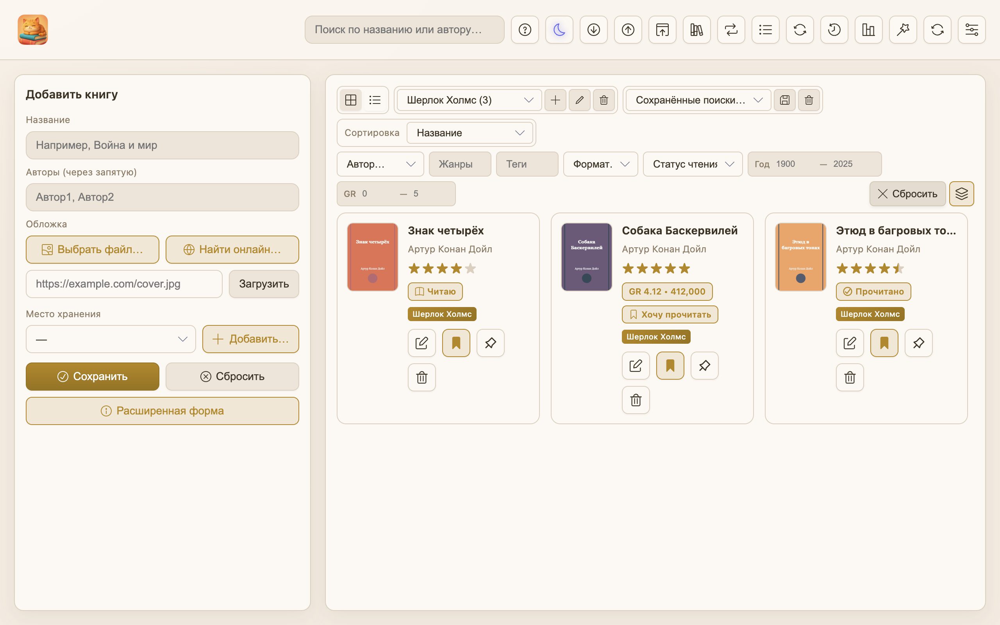
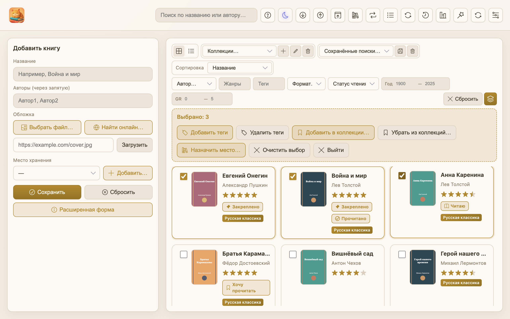

## Коллекции

Коллекция — это именованный список книг: «Русская классика», «Подарить», «На лето» и так далее.
Одна книга может входить в несколько коллекций.

**Создать:** кнопка **«+»** рядом с селектом **«Коллекции…»**. Рядом — переименовать и удалить
выбранную коллекцию.

**Добавить книгу в коллекцию** можно тремя способами:

- кнопка-**закладка** на карточке книги;
- кнопка **«Коллекции»** в карточке книги;
- [массовое редактирование](#массовое-редактирование) для нескольких книг сразу.

Откроется окно со списком коллекций и числом книг в каждой. Отметьте нужные или создайте новую прямо
здесь.

**Посмотреть коллекцию:** выберите её в селекте — список покажет только её книги. На карточках есть
бейджи с названиями коллекций.

:::note
Коллекции из интерфейса создаются только «статические» — с ручным списком книг. Для подборок по
условию используйте [сохранённые поиски](/guide/search/#сохранённые-поиски).
:::

## Закреплённые книги

Кнопка-**булавка** на карточке закрепляет книгу: она всегда показывается в начале списка с бейджем
«Закреплено», при любой сортировке. Удобно для того, что читаете сейчас. Повторное нажатие
открепляет. Закрепления синхронизируются, в мобильном приложении закрепить можно свайпом.

## Массовое редактирование

Кнопка со **стопкой слоёв** справа от «Сбросить» включает режим выбора: на карточках появляются
чекбоксы, сверху — панель действий.

Действия для выбранных книг:

- **добавить теги** и **удалить теги**;
- **добавить в коллекции** и **убрать из коллекций**;
- **назначить место хранения**;
- **очистить выбор** и **выйти** из режима (или `Esc`).
