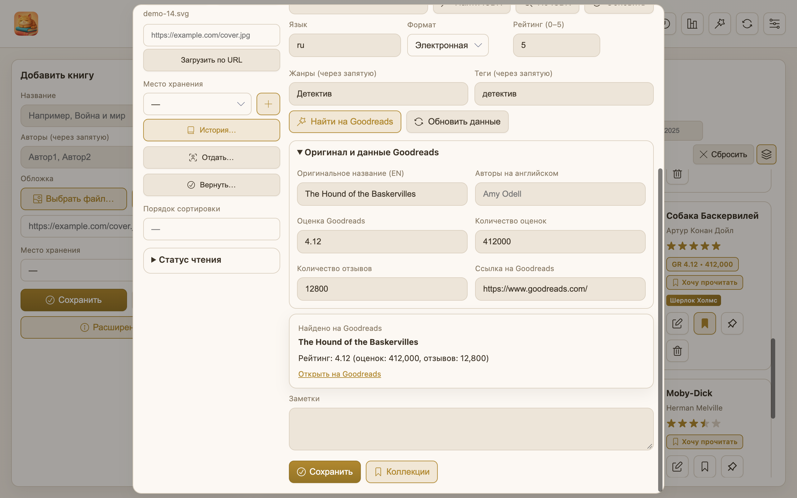
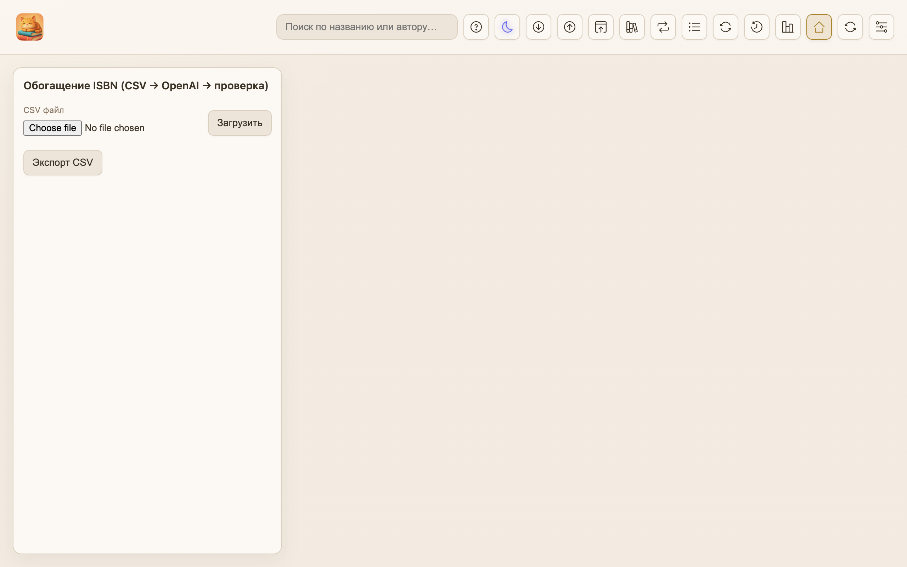

## Данные по ISBN

В [карточке книги](/guide/books/#карточка-книги) рядом с полем ISBN есть три кнопки:

- **«По ISBN»** — найти книгу по номеру и показать варианты;
- **«Обновить»** — то же самое, но без кэша;
- **«Найти ISBN»** — подобрать ISBN по названию и автору через AI (см. ниже).

Найденные варианты показываются списком. У каждого есть кнопка **«Применить»** — она заполнит
пустые поля карточки — и **«Кириллицей»** для издательства.

Откуда берутся данные:

1. **ISBNdb** — если в [настройках](/guide/settings/) указан ключ ISBNdb;
2. иначе **Open Library** — бесплатно и без ключа.

Ответы кэшируются: найденное — на 14 дней, пустой ответ — на 10 минут.

## Поиск ISBN через AI

Кнопка **«Найти ISBN»** отправляет название, авторов, издательство и год выбранному AI-провайдеру, а
затем проверяет предложенный ISBN через ISBNdb или Open Library. Ответы AI кэшируются на 30 дней.

Нужен ключ одного из провайдеров (настраивается в [настройках](/guide/settings/#ai)):

- **OpenAI** — модели GPT-5, GPT-4o, o1 и другие; можно указать свой API base URL (совместимые
  сервисы);
- **Perplexity** — модели `sonar`, `sonar-pro` и другие.

**«Строгий режим»** в настройках даёт меньше результатов, но точнее.

## Goodreads

В карточке книги есть блок **«Оригинал и данные Goodreads»**:

- **«Найти на Goodreads»** — AI находит страницу книги на Goodreads, приложение читает с неё рейтинг,
  число оценок и отзывов;
- **«Обновить данные»** — перечитать страницу по уже сохранённой ссылке;
- поля **«Оригинальное название (EN)»** и **«Авторы на английском»** помогают найти переводную книгу.

Рейтинг Goodreads потом виден на карточке (`GR 4.12 • 412 000`), по нему можно
[сортировать, фильтровать и искать](/guide/search/) (`gr:>=4.2`).

:::note
Нужен ключ AI-провайдера. Чтение рейтинга зависит от вёрстки сайта Goodreads и может сломаться,
если сайт изменится.
:::

## Пакетное обогащение CSV

Кнопка с **волшебной палочкой** в шапке открывает экран **«Обогащение ISBN»**. Он нужен, когда есть
таблица книг без ISBN:

1. Загрузите CSV и сопоставьте колонки: название, авторы, издательство, год. Есть флаг «CSV без
   заголовка».
2. Нажмите **«Начать»** — для каждой строки AI предложит ISBN, а приложение проверит его по базам.
   Обработку можно поставить на паузу.
3. В строке результата можно **«Принять»** вариант или **«Перепроверить»**.
4. **«Экспорт CSV»** скачает `enriched.csv` с найденными ISBN.

:::caution
Этот экран ничего не добавляет в библиотеку — результат только в CSV. Чтобы занести книги, импортируйте
полученный файл через [импорт CSV](/guide/import-export/#импорт-csvtsv).
:::
