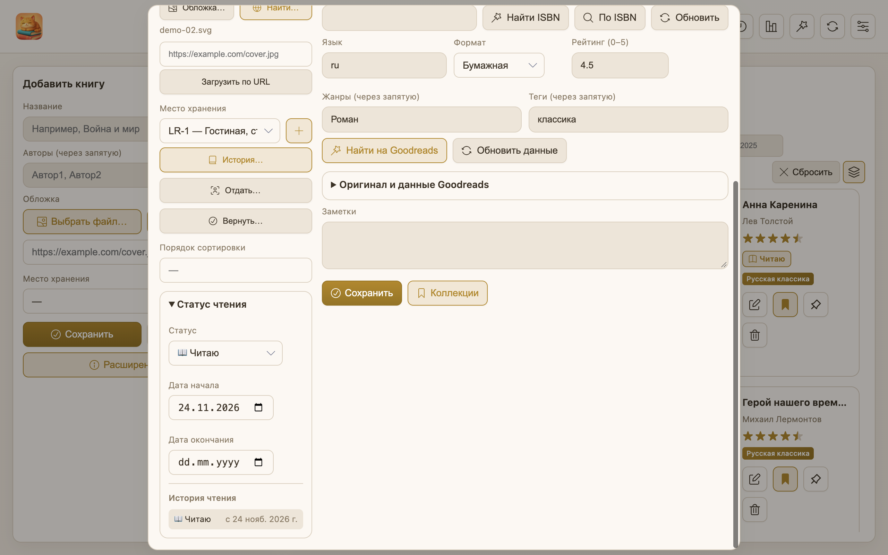
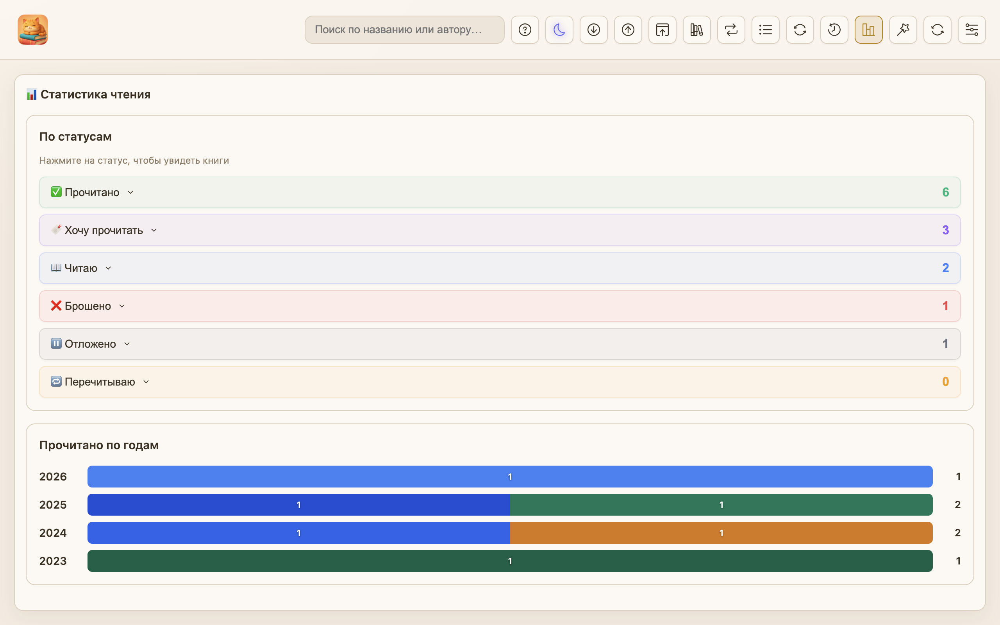

## Статус чтения

В карточке книги есть раскрывающийся блок **«Статус чтения»**:

Статусы:

| Статус | Когда ставить |
|---|---|
| Хочу прочитать | В планах |
| Читаю | Сейчас в процессе — проставляется дата начала |
| Прочитано | Дочитали — проставляется дата окончания |
| Перечитываю | Читаете повторно |
| Брошено | Бросили и не планируете возвращаться |
| Отложено | Пауза |

Даты начала и окончания можно поправить вручную. Каждое прочтение сохраняется в **«Истории чтения»**:
если перечитать книгу, предыдущая сессия не потеряется.

Статус виден бейджем на карточке, по нему работает [фильтр](/guide/search/#фильтры) «Статус чтения».

## Статистика

Кнопка **«Статистика чтения»** (столбики) в шапке:

- **По статусам** — сколько книг в каждом статусе. Клик по строке раскрывает список книг.
- **Прочитано по годам** — раскрывающийся блок со столбиками по годам и месяцам окончания чтения.
