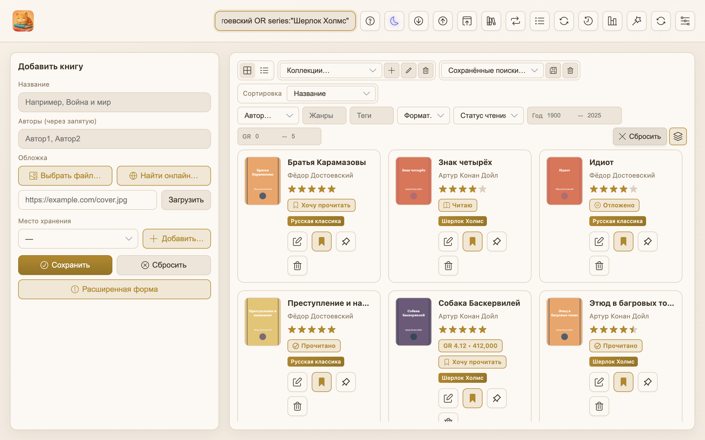
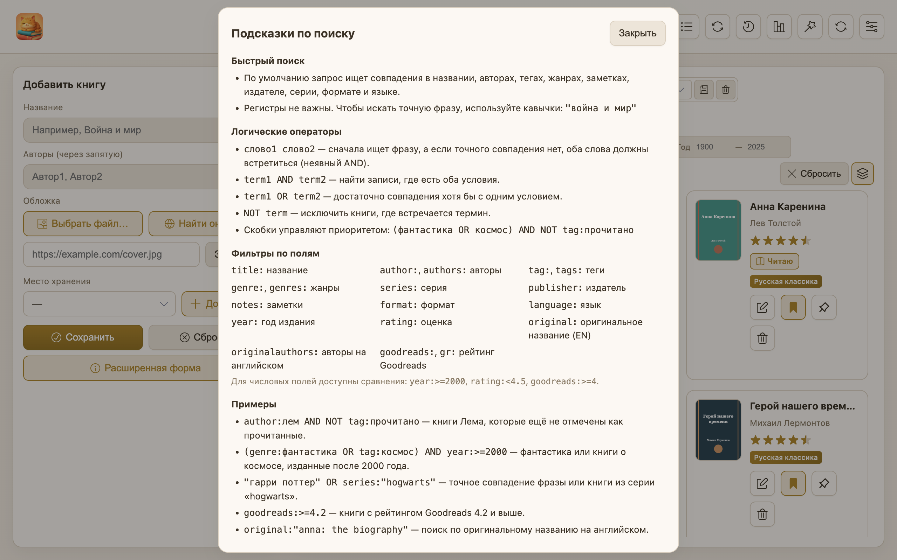
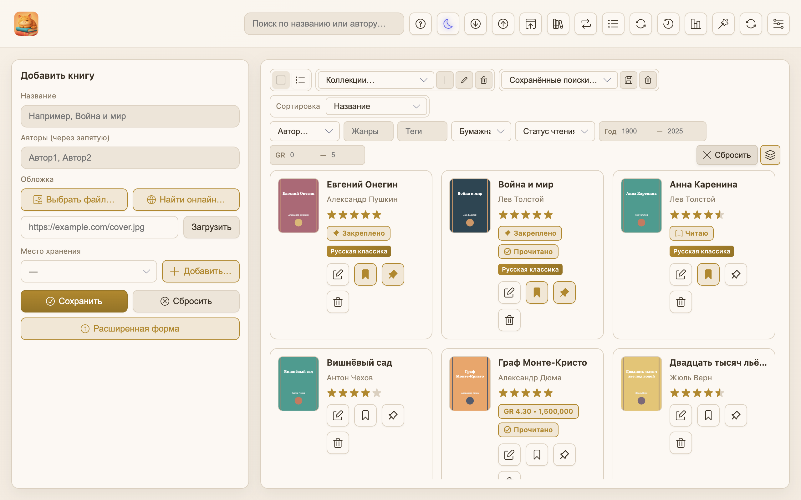

## Быстрый поиск

Поле в шапке (горячая клавиша `/`). По умолчанию ищет в названии, авторах, тегах, жанрах, заметках,
издателе, серии, формате и языке. Регистр не важен.

На скриншоте запрос `author:Достоевский OR series:"Шерлок Холмс"` — книги Достоевского или из
серии о Шерлоке Холмсе.

## Синтаксис запросов

Полная шпаргалка открывается кнопкой **«?»** рядом с поиском.

### Логические операторы

| Запрос | Значение |
|---|---|
| `"война и мир"` | Точная фраза |
| `слово1 слово2` | Сначала ищется фраза; если её нет — должны встретиться оба слова |
| `term1 AND term2` | Оба условия |
| `term1 OR term2` | Хотя бы одно условие |
| `NOT term` | Исключить книги с термином |
| `(фантастика OR космос) AND NOT tag:прочитано` | Скобки задают приоритет |

### Поля

| Поле | Что ищет |
|---|---|
| `title:` | Название |
| `author:`, `authors:` | Авторы |
| `tag:`, `tags:` | Теги |
| `genre:`, `genres:` | Жанры |
| `series:` | Серия |
| `publisher:` | Издатель |
| `notes:` | Заметки |
| `format:` | Формат (`paper`, `ebook`, `audiobook`) |
| `language:` | Язык |
| `year:` | Год издания |
| `rating:` | Ваша оценка |
| `original:` | Оригинальное название (EN) |
| `originalauthors:` | Авторы на английском |
| `goodreads:`, `gr:` | Рейтинг Goodreads |

Для чисел работают сравнения: `year:>=2000`, `rating:<4.5`, `gr:>=4.2`.

### Примеры

- `author:лем AND NOT tag:прочитано` — книги Лема, ещё не отмеченные прочитанными;
- `(genre:фантастика OR tag:космос) AND year:>=2000` — фантастика или книги о космосе после 2000 года;
- `"гарри поттер" OR series:"hogwarts"` — точная фраза или серия;
- `goodreads:>=4.2` — рейтинг Goodreads 4.2 и выше;
- `original:"anna: the biography"` — поиск по оригинальному названию.

:::note
Нечёткий поиск (с опечатками) сейчас не работает: библиотека Fuse.js не загружается. Поиск находит
только точные вхождения. Подробнее — в [известных ограничениях](/reference/limitations/).
:::

## Фильтры

Под строкой коллекций — панель фильтров: **автор**, **жанры**, **теги**, **формат**, **статус чтения**
(включая «Без статуса»), **год от–до** и **рейтинг Goodreads от–до**. Фильтры сочетаются с поиском.
**«Сбросить»** очищает всё.

Последний набор фильтров и поиск запоминаются и восстанавливаются при следующем запуске.

## Сортировка

Выпадающий список **«Сортировка»**: по названию, автору, дате добавления, рейтингу Goodreads или серии
(внутри серии — по номеру). Независимо от сортировки сверху всегда идут:

1. книги с ручным **«Порядком сортировки»** из карточки;
2. **закреплённые** книги (новые закрепления выше).

## Сохранённые поиски

Чтобы не набирать сложный запрос заново:

1. настройте поиск и фильтры;
2. нажмите кнопку **сохранения** рядом с **«Сохранённые поиски…»** и введите имя.

Сохранённый поиск восстанавливает и строку запроса, и все фильтры. Удаляется кнопкой с корзиной.
Сохранённые поиски синхронизируются между устройствами.
