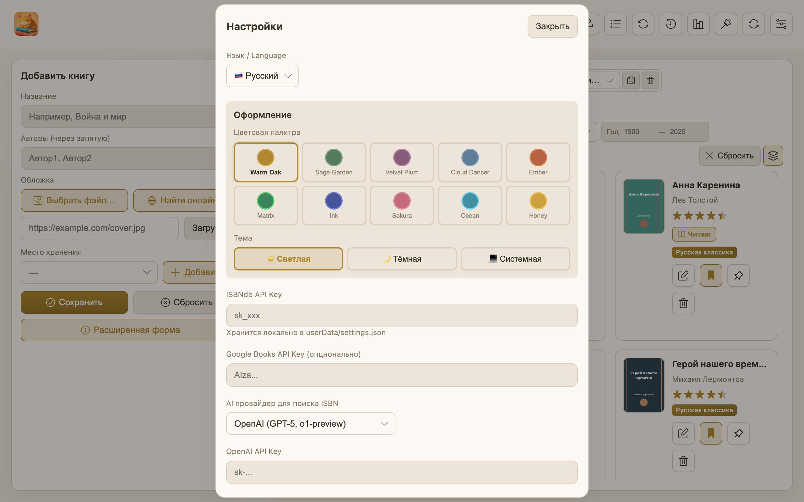
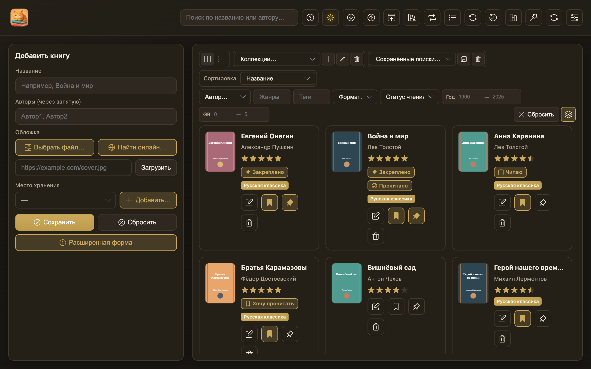

Настройки открываются кнопкой с **ползунками** справа в шапке.

## Язык

Русский или English. Если язык не выбран, используется язык системы.

:::note
Перевод на английский неполный: часть сообщений, диалог синхронизации и подписи на карточках
остаются на русском.
:::

## Оформление

- **Цветовая палитра** — 10 вариантов: Warm Oak (по умолчанию), Sage Garden, Velvet Plum, Cloud
  Dancer, Ember, Matrix, Ink, Sakura, Ocean, Honey.
- **Тема** — светлая, тёмная или системная (следует настройке macOS/Windows).

Кнопка с луной в шапке быстро переключает светлую и тёмную тему.

## Ключи сервисов

| Ключ | Зачем |
|---|---|
| ISBNdb API Key | Поиск по ISBN через ISBNdb. Без ключа используется Open Library |
| Google Books API Key | Сейчас не используется, см. [ограничения](/reference/limitations/) |

Все ключи хранятся **локально** в файле настроек приложения и не уходят в облако при синхронизации.

## AI

- **AI-провайдер** — OpenAI или Perplexity;
- ключ и модель выбранного провайдера;
- для OpenAI — свой **API base URL**, если используете совместимый сервис;
- **«Отключить кэширование AI-запросов»** — для отладки;
- **«Строгий режим AI-поиска»** — меньше результатов, но точнее.

Для чего нужен AI, описано в разделе [ISBN, AI и Goodreads](/guide/metadata/).

## Синхронизация

Описана в отдельном разделе [Синхронизация](/guide/sync/).

## Горячие клавиши

| Клавиша | Действие |
|---|---|
| `/` | Перейти в поиск |
| `N` | Новая книга (полная карточка) |
| `Enter` | Сохранить карточку или быструю форму |
| `Delete` | Удалить выбранную или открытую книгу |
| `Esc` | Закрыть окно (спросит, если есть несохранённые правки) или выйти из массового режима |

Клавиши не срабатывают, пока курсор стоит в поле ввода — кроме `Enter` и `Esc`.
