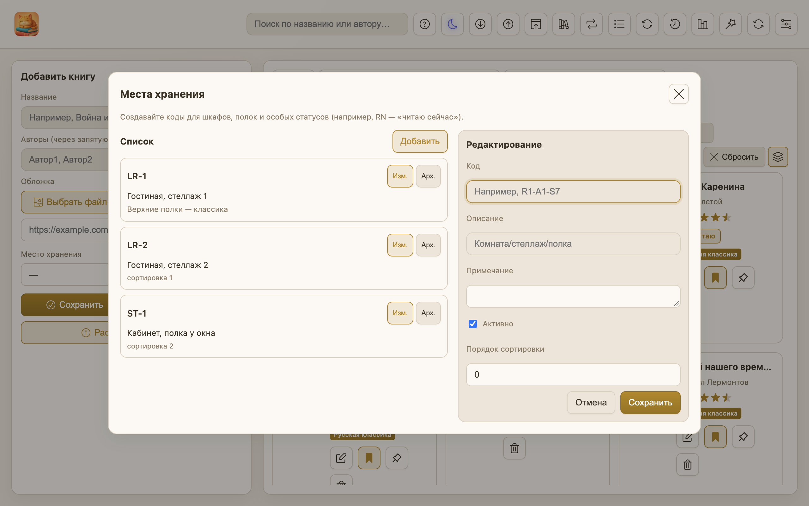
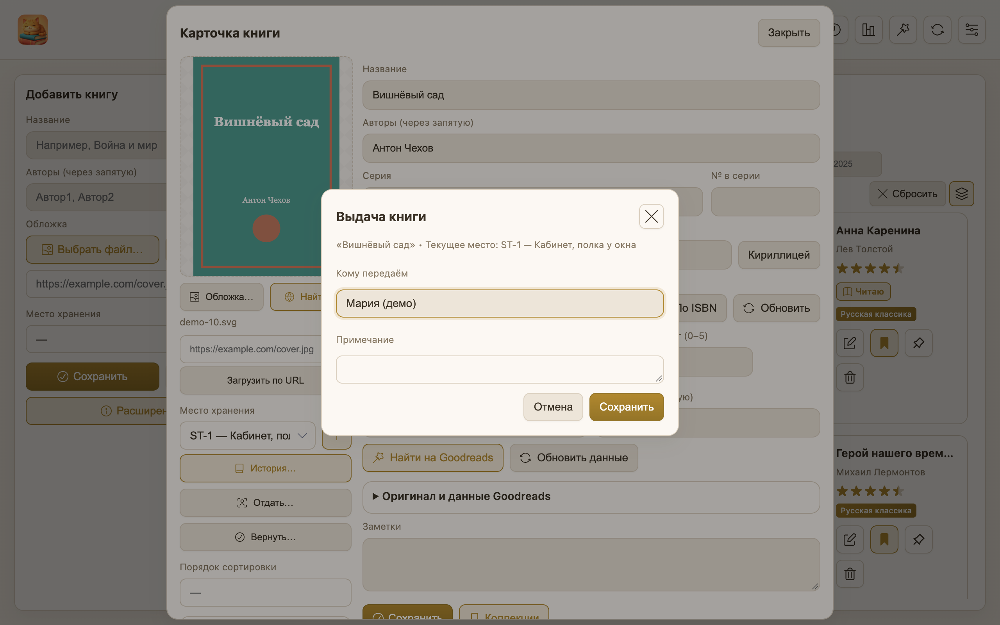

## Места хранения

Место хранения — это полка, шкаф или условное место с коротким кодом. Например, `LR-1` —
«Гостиная, стеллаж 1». Код виден в карточке книги и в окне информации.

Менеджер открывается кнопкой **«Места хранения»** (книги на полке) в шапке.

У места есть:

- **код** — короткий, например `R1-A1-S7`;
- **описание** — «Комната / стеллаж / полка»;
- **примечание**;
- флаг **«Активно»** и **порядок сортировки** в списках.

Места не удаляются, а **архивируются** (кнопка «Арх.»): старые записи истории остаются понятными.

Назначить место книге можно:

- в быстрой форме или в карточке книги — селект **«Место хранения»** (кнопка «+» рядом создаёт новое
  место, не уходя из формы);
- для многих книг сразу — через [массовое редактирование](/guide/collections/#массовое-редактирование).

## История перемещений

Кнопка **«История…»** в карточке книги показывает, где книга стояла раньше и когда её переставили.

## Выдача книг

Если вы одолжили книгу, отметьте это кнопкой **«Отдать…»** в карточке книги:

Укажите, **кому** отдаёте, и при желании примечание. На карточке книги появится бейдж **«Отдана»**,
а в подсказке к нему — кому и когда. Когда книгу вернули, нажмите **«Вернуть…»** и выберите, на какое
место её поставить.

:::note
Сроков возврата и напоминаний пока нет.
:::
