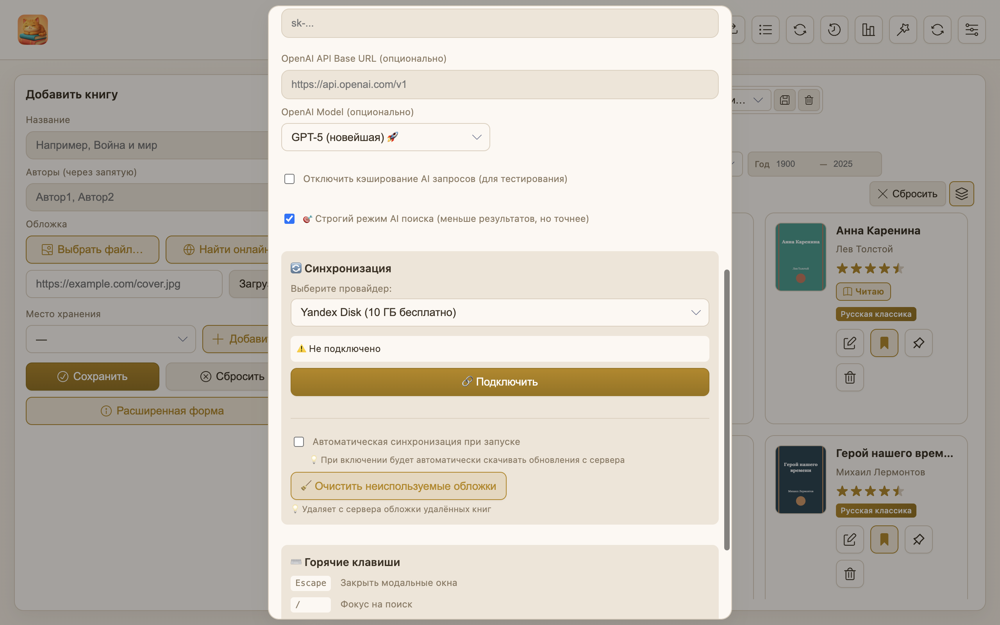

Синхронизация нужна, чтобы одна и та же библиотека была на нескольких компьютерах и в
[мобильном приложении](/mobile/overview/). Отдельного «сопряжения» устройств нет: каждое устройство
подключается к одному и тому же облаку.

## Подключение облака

1. Откройте [настройки](/guide/settings/) и прокрутите до блока **«Синхронизация»**.
2. Выберите провайдера: **Яндекс Диск**, **Google Drive** или **Dropbox**.
3. Нажмите **«Подключить»** — откроется браузер со входом в аккаунт. После входа вкладку можно
   закрыть, приложение получит доступ само.

Одновременно активен только один провайдер. **«Проверить подключение»** показывает, что доступ есть.

## Как синхронизировать

Кнопка **«Синхронизация»** (две стрелки) в шапке открывает окно синхронизации. В нём видно:

- провайдер и аккаунт;
- **данные в облаке** — когда и с какого устройства их загрузили, и есть ли там что-то новее ваших
  данных;
- **локальные изменения** — сколько книг, коллекций и прочего изменено с последней синхронизации.

Дальше выберите направление:

- **«Загрузить на сервер»** — отправить ваши изменения в облако;
- **«Скачать с сервера»** — забрать изменения с других устройств.

## Как сливаются изменения

Для облачных провайдеров синхронизация идёт **по отдельным записям**, а не целым файлом базы. Книги,
авторы, коллекции, сессии чтения, места хранения, сохранённые поиски и справочники сливаются по
правилу **«последнее изменение побеждает»**. Удаления тоже синхронизируются: удалённая на одном
устройстве книга исчезнет и на другом.

В облако также уходят обложки и настройки, но **без ключей и токенов**. На Яндекс Диске данные лежат в
папке приложения `Приложения/LibraryManager`.

Если в облаке данные от более новой версии приложения (новее схема базы), синхронизация
блокируется. Обновите приложение на этом устройстве.

## S3

Кроме облачных дисков есть синхронизация через S3-совместимое хранилище: Timeweb, Yandex Object
Storage, AWS и другие. Она работает иначе — передаёт **целиком файл базы**, без слияния по записям.

Параметры S3 (endpoint, регион, бакет, ключи) задаются в настройках, кнопка **«Проверить подключение
к S3»** проверяет доступ.

:::caution[Ограничения S3 сейчас]
- Включить S3 как провайдера из интерфейса нельзя: это работает, только если провайдер уже записан в
  файле настроек.
- **«Автоматическая синхронизация при запуске»** и **«Очистить неиспользуемые обложки»** видны для
  любого провайдера, но работают только с S3. Автосинхронизация при этом только скачивает данные.

Подробности — в [известных ограничениях](/reference/limitations/).
:::
