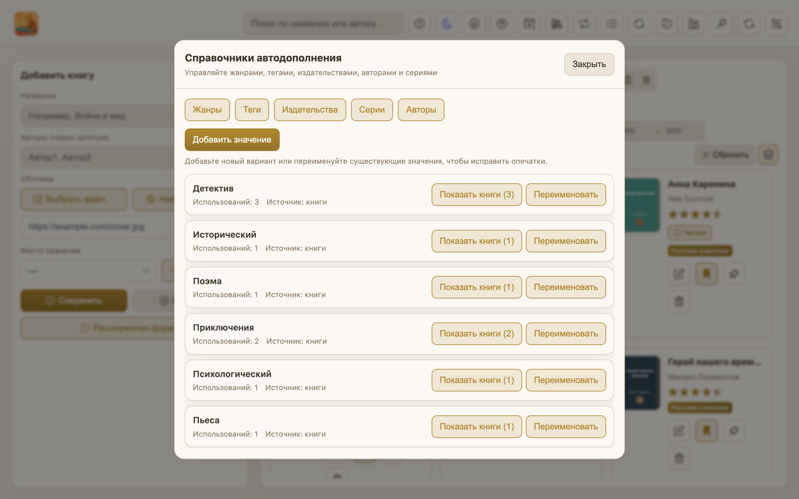
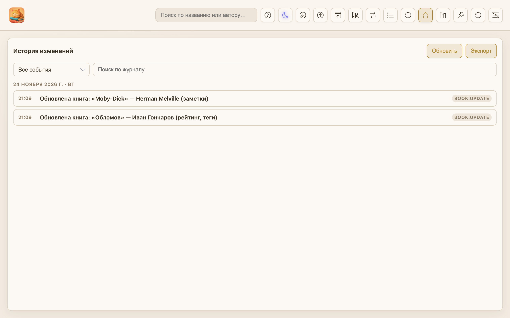

## Справочники автодополнения

Кнопка **«Справочники автодополнения»** (список) в шапке. Вкладки: **жанры, теги, издательства,
серии, авторы**.

Для каждого значения видно, сколько книг его используют. Что можно сделать:

- **«Показать книги»** — список книг с этим значением;
- **«Переименовать»** — исправить значение **во всех книгах сразу**. Так удобно чинить опечатки и
  объединять дубли: «Фантастика» и «фантастика», «Толстой Л.» и «Лев Толстой»;
- **«Добавить значение»** — заранее добавить вариант в подсказки, даже если ни одна книга его ещё не
  использует;
- **удалить** — только значения, добавленные вручную.

## Журнал изменений

Кнопка **«История изменений»** (часы) в шапке. Приложение записывает каждое действие: добавление,
правку и удаление книг, изменения мест хранения, синхронизации, бэкапы.

- фильтр по категории: все события, книги, места хранения, синхронизация, бэкапы, журнал;
- поиск по журналу и **«Загрузить ещё»** для более старых записей;
- клик по записи раскрывает изменения полей **«было → стало»**;
- **«Экспорт»** сохраняет до 10 000 записей в `library-activity-ГГГГ-ММ-ДД.json`.
