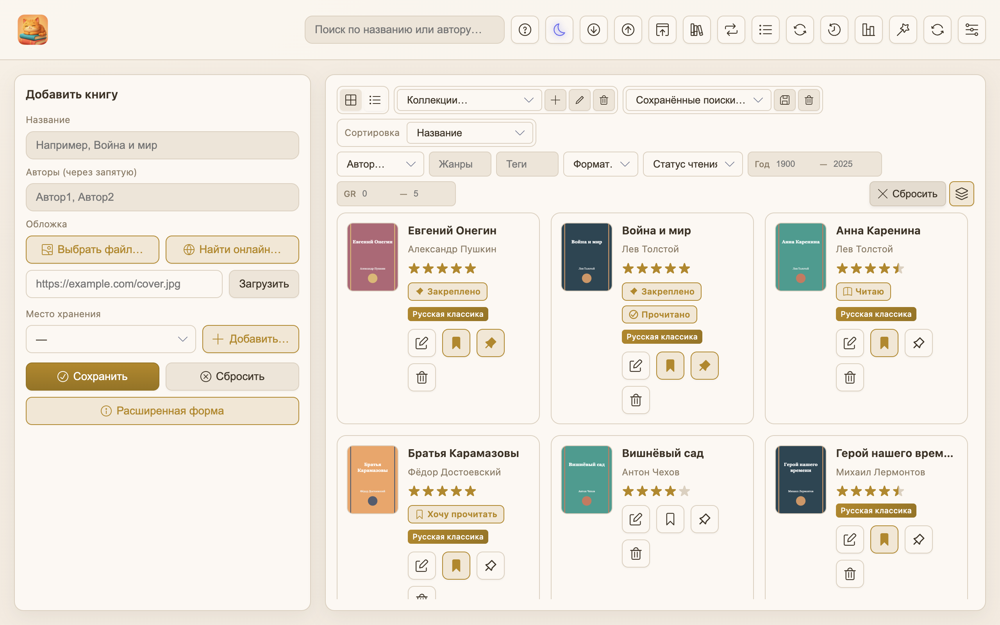
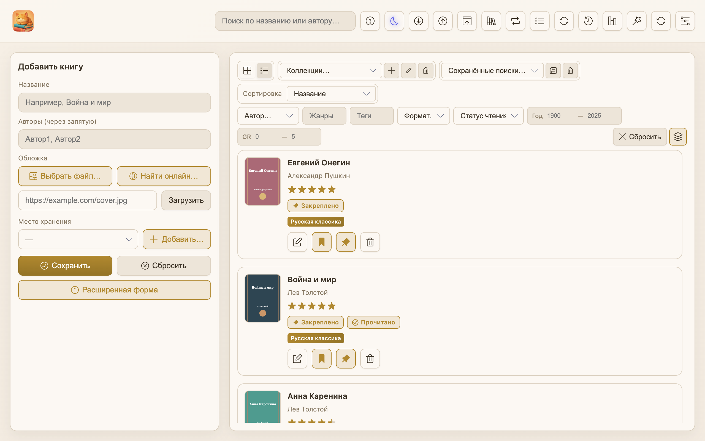

Окно состоит из трёх частей:

1. **Шапка** — поиск и кнопки всех разделов.
2. **Форма «Добавить книгу»** слева — быстрое добавление книги. На узком окне (меньше 1024 px) она
   сворачивается.
3. **Список книг** справа — коллекции, сохранённые поиски, сортировка, фильтры и сами карточки.

## Кнопки шапки

У кнопок нет подписей — только иконки. Название появляется при наведении. Слева направо:

| Кнопка | Что делает | Подробнее |
|---|---|---|
| Поле поиска | Поиск по библиотеке, горячая клавиша `/` | [Поиск и фильтры](/guide/search/) |
| ? | Подсказки по синтаксису поиска | [Поиск и фильтры](/guide/search/) |
| Луна / солнце | Переключить светлую и тёмную тему | [Настройки](/guide/settings/) |
| Стрелка вниз | Бэкап: сохранить всю библиотеку в JSON | [Импорт и экспорт](/guide/import-export/) |
| Стрелка вверх | Импорт резервной копии | [Импорт и экспорт](/guide/import-export/) |
| Ящик со стрелкой | Импорт CSV/TSV | [Импорт и экспорт](/guide/import-export/) |
| Книги на полке | Места хранения | [Места хранения](/guide/storage/) |
| Две стрелки | Синхронизация | [Синхронизация](/guide/sync/) |
| Список | Справочники автодополнения | [Справочники и журнал](/guide/vocabulary/) |
| Круговая стрелка | Проверить обновления | [Установка](/start/install/#обновления) |
| Часы | История изменений | [Справочники и журнал](/guide/vocabulary/#журнал-изменений) |
| Столбики | Статистика чтения | [Чтение и статистика](/guide/reading/) |
| Волшебная палочка | Обогащение CSV через AI | [ISBN, AI и Goodreads](/guide/metadata/#пакетное-обогащение-csv) |
| Круговая стрелка | Перезагрузить окно без кэша | — |
| Ползунки | Настройки | [Настройки](/guide/settings/) |

Кнопки «История», «Статистика» и «Обогащение» переключают основную область на отдельный экран.
Пока экран открыт, иконка его кнопки превращается в **домик** — нажмите её, чтобы вернуться к
библиотеке.

## Список книг

Над списком расположены:

- переключатель **сетка / список**;
- **Коллекции…** — выбор коллекции и кнопки «создать», «переименовать», «удалить»;
- **Сохранённые поиски…** — сохранить текущий поиск и фильтры или удалить сохранённый;
- **Сортировка** — по названию, автору, дате добавления, рейтингу Goodreads или серии;
- **фильтры** — автор, жанры, теги, формат, статус чтения, год и рейтинг Goodreads;
- **Сбросить** и кнопка **массового редактирования** справа.

## Карточка книги

На карточке видны обложка, название, авторы и рейтинг звёздами. Бейджи показывают:

- рейтинг Goodreads (`GR 4.12 • 412 000`);
- «Закреплено» — книга всегда наверху списка;
- статус чтения («Читаю», «Прочитано»…);
- коллекции, в которые входит книга;
- «Отдана» — если книгу кому-то одолжили.

Кнопки на карточке: **редактировать**, **коллекции** (закладка), **закрепить** (булавка) и
**удалить**. Клик по самой карточке открывает окно с информацией о книге.
